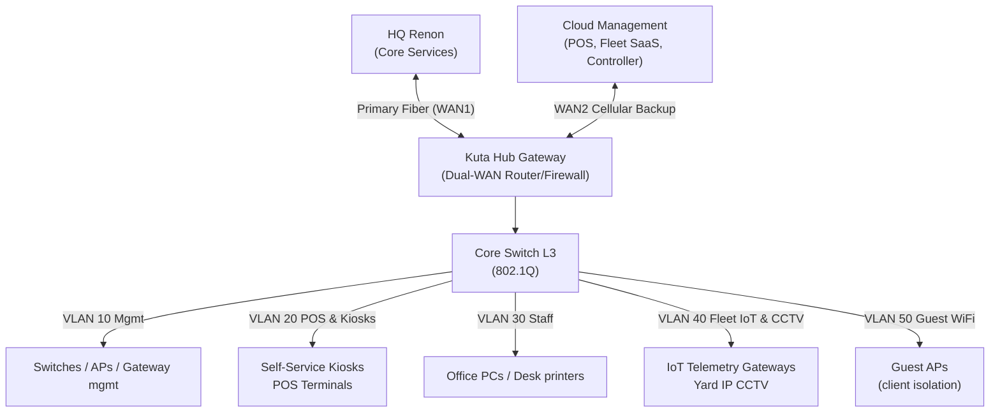

# Network Architecture - Kuta Hub Branch

Incident context: primary fiber severed during a thunderstorm; gateway failed over to unstable cellular backup (jitter > 400 ms, 18% packet loss, flapping). This document defines the topology, VLAN plan, and dual-WAN failover policy that prevents a repeat.

## 1. Topology Design



Key points:
- WAN1 (fiber) is primary for all traffic. WAN2 (cellular) is backup only, entered when WAN1 health checks fail for < 3 s.
- The Kuta Hub gateway is the single policy enforcement point: QoS marking, inter-VLAN ACLs, and WAN failover all live here so policy survives switch reboots.
- Guest Wi-Fi (VLAN 50) never terminates on the same uplink priority as POS/kiosks; when on WAN2 it is throttled to near-zero (see Section 3).

## 2. 802.1Q VLAN Matrix

| VLAN | Name | Target Subnet | DHCP Scope | QoS / Priority | Inter-VLAN Routing Rules |
|------|------|---------------|------------|----------------|--------------------------|
| 10 | Management | 10.10.10.0/24 | .100-.200, 12h lease | DSCP CS6, highest queue | Strictly isolated. Reachable ONLY from a dedicated mgmt jumphost (VLAN 30 exception: 2 host IPs). No route to/from VLAN 50. |
| 20 | POS & Kiosks | 10.10.20.0/24 | .50-.240, 8h lease | DSCP EF, strict priority queue #1 | May reach HQ POS backend + payment gateway (WAN1/WAN2). Blocked from VLAN 30/40/50 except DNS + NTP. |
| 30 | Staff | 10.10.30.0/24 | .100-.250, 24h lease | DSCP AF31, queue #3 | Internet allowed (rate-limited 10 Mbps/client). May reach VLAN 10 only from 2 jumphost IPs. No access to VLAN 20/40. |
| 40 | Fleet IoT & CCTV | 10.10.40.0/24 | static reservations only | DSCP AF41, queue #2 | Outbound telemetry to cloud fleet SaaS only (fixed FQDN/IP + port). **No public internet ingress** (no port forwarding, no inbound NAT). Blocked from VLAN 30/50. |
| 50 | Guest Wi-Fi | 172.16.50.0/22 | .10.1-.10.1022, 2h lease | DSCP CS1, best-effort, 2 Mbps/client hard cap | Internet only. Client isolation (private-VLAN / AP isolation). No inter-VLAN access at all. Blocked from WAN2 when degraded (Section 3). |

DHCP servers live on the gateway; VLAN 40 uses static reservations because IoT gateways and CCTV NVRs must keep fixed addresses for allowlist ACLs.

## 3. Dual-WAN Failover & Traffic Shaping

### Health checks
- Tracked IPs: HQ gateway `10.0.0.1` (primary probe), cloud controller `1.2.3.4` (secondary probe). Both must fail before failover, to avoid flapping on a single unreachable host.
- Probe: ping every **2 s**, timeout 1 s, fail threshold **3 consecutive losses**, recover threshold **5 consecutive successes** (with hold-down timer 30 s) before returning to WAN1.
- Failover trigger target: **< 3 s** from WAN1 loss to WAN2 active.

### WAN2 (cellular backup) shaping rules
```
rule 10: from VLAN20 -> permit, commit burst 4 Mbps, sustained 2 Mbps   # POS/kiosks first
rule 20: from VLAN40 -> permit, 512 kbps aggregate                     # fleet telemetry, still flows
rule 30: from VLAN10 -> permit, 256 kbps                               # controller heartbeats survive
rule 40: from VLAN30 -> throttle 1 Mbps aggregate                      # staff squeezed
rule 50: from VLAN50 -> deny when WAN2_active == true                  # guests: 0 kbps
         (alternative degraded mode: throttle < 128 kbps aggregate)
```

Rationale: the outage report showed unthrottled guest Wi-Fi starving POS terminals and cloud controller heartbeats. Rule 50 (deny or < 128 kbps) guarantees the cellular uplink is reserved for revenue-critical (VLAN 20) and safety-critical (VLAN 40) traffic.

### Flapping protection
- Failover hold-down: 30 s minimum on WAN2 before re-evaluating WAN1.
- WAN2 admission control: if cellular jitter > 300 ms sustained 60 s, only rules 10-30 (POS, IoT, mgmt) remain permitted and VLAN 50/30 are dropped entirely.

## 4. Kiosk-side protections (links to Part 2)
- Kiosk clients receive `409 Conflict` on concurrent checkout and MUST NOT blind-retry payment capture; retry only with the same idempotency key (server dedup) or after user confirmation.
- Kiosk request timeout budget on WAN2: 8 s, max 2 attempts.
